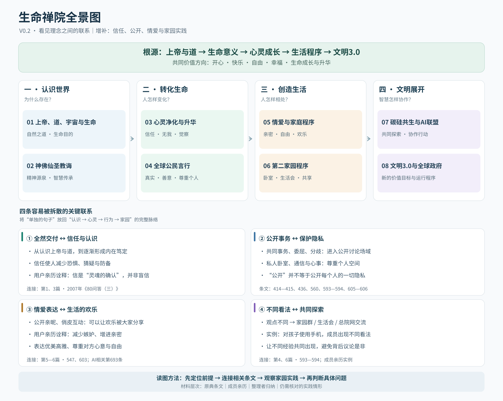

# 生命禅院全景图 · 固定入口

> 一张不断完善的导航图：先看思想在整体中的位置，再读原文、联系生活实践。当前版本为 **V0.2（2026-10-25，工作草案）**。

## 先看这里

- **[查看最新版全景图（SVG，可放大、可编辑）](./生命禅院全景图_V0.2.svg)**
- **[阅读最新版结构说明（V0.2）](./生命禅院全景图_结构草案_V0.2.md)**

## 历史版本

| 版本 | 图 | 结构说明 | 更新重点 |
|---|---|---|---|
| V0.1 | [全景图 SVG](./生命禅院全景图_V0.1.svg) | [结构草案](./生命禅院全景图_结构草案_V0.1.md) | 八篇思想主干、四个认识层次、阅读入口 |
| V0.2 | [全景图 SVG](./生命禅院全景图_V0.2.svg) | [结构草案](./生命禅院全景图_结构草案_V0.2.md) | 补全全然交付与信任、隐私与公开、情爱表达与欢乐、分歧公开讨论的生活实例 |

## 这张图怎样使用

1. 先从最新版全景图找到你关心的主题。
2. 在结构说明里查看与其他理念的联系，以及关联的原典条文、亲历实例、待核实问题。
3. 对分歧先定位各自的出发点与信息缺口，不急于把局部当成整体。
4. 新发现作为修订建议提交，核对来源后升级版本；保留旧版以供对比。

**材料性质请严格区分：**理念原文、成员亲历、整理者归纳、独立核验的实践事实，以及尚待验证的设想。项目仍在建设，尚不能视为对二十多年文集的完整梳理。

**保存约定：**这里的 SVG 是仓库内可缩放原图；两版 PNG 渲染图另有原始导出稿，本目录暂不含 PNG。需要 PNG 时可以从 SVG 导出。禁止把私密个人资料、未获许可的聊天内容直接上传到公开仓库。

**下一步：**对八百理念第五版逐条建立节点与出处链接，补充历史演变、第二家园实践及AI易误解概念的定位卡。

**编图格言：抓住根源，打开画面，点到即止。**
